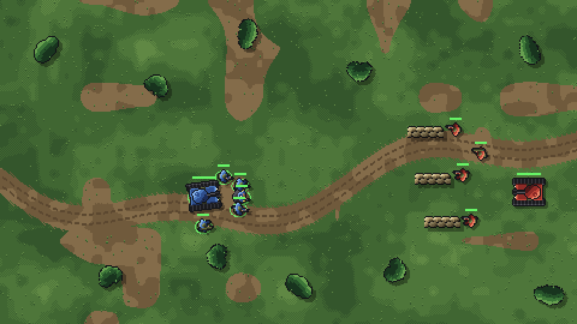
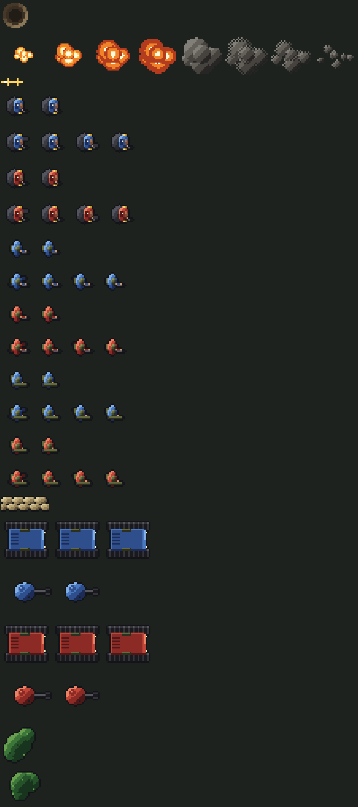

# rts-sprite-spike

[](https://github.com/jnbowmar/rts-sprite-spike/actions/workflows/test.yml)



I have a small-army strategy game parked on my list, and art is the part a solo developer runs out of time for. This repo is a weekend test of one idea: draw every sprite with code, then drop the sprites into a Godot scene and see if the result holds up.

Every pixel here comes from one Python script. The infantry, the tanks and their turrets, the explosions, the trees and sandbags, and the map are all drawn in `sprites.py`. The two factions share the same drawings with a different four-color ramp, so a third faction would be one more line in the `TEAMS` table.



## Run it

You need Python 3.13 and Godot 4.7.

```bash
python -m venv .venv
.venv/bin/pip install -r requirements.txt
.venv/bin/python sprites.py
godot --path game
```

`sprites.py` writes the art into `game/art` and a contact sheet to `preview.png`. The Godot scene loads the PNGs at runtime, so there is no import step. Right-click anywhere to move the blue squad.

## What I learned

The units are drawn top-down facing right and rotated by the engine. That means one drawing per unit instead of eight directions, which is what made this practical.

The tanks, effects and props look close to finished at game scale. The infantry are 20 pixels across and read as soldiers mostly because of the team color and the rifle. They work as placeholders. A pixel artist would do better.

The real payoff is iteration speed. Changing a helmet size, a leg stride or a faction color is a one-number edit and the whole set regenerates in about a second.

## Tests

`pytest` checks that every sprite strip has the frame layout the scene expects, that the two factions differ only in color, and that the committed art matches what the generator produces.

## License

MIT
